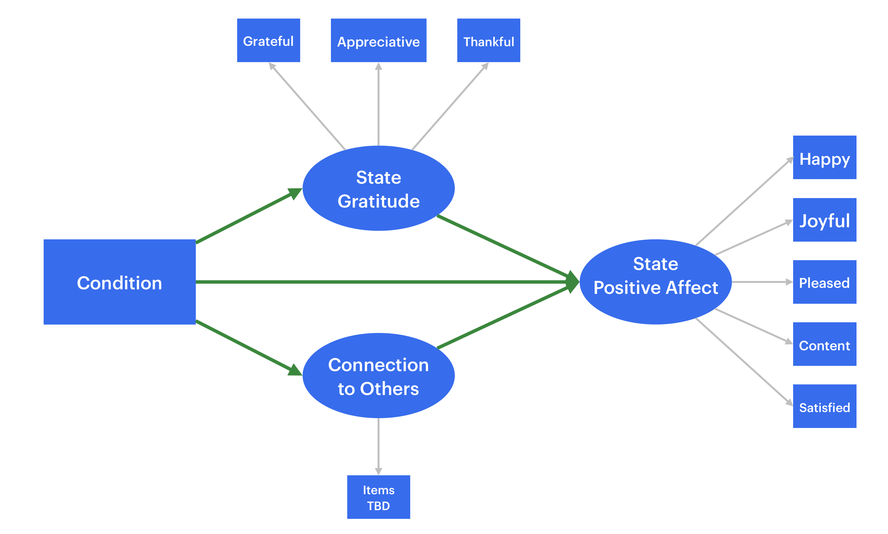

## Introduction

Dang et al. (2025) sought to test 7 gratitude interventions that are used in positive psychology to improve subjective well-being. These interventions included intrapersonal, interpersonal, and gratitude-to-God interventions. While studies in the literature have examined these interventions before, such studies are heterogeneous in their selection of outcome measures for subjective well-being and only compare a few interventions against each other, making comparisons across excluded interventions difficult. By contrast, this study included a comprehensive battery of interventions and standardized outcome measures (i.e., state gratitude, state positive/negative affect, and life satisfaction). As a result, this experiment allows for a direct comparison of efficacy between the gratitude interventions and can inform what gratitude practices are most helpful for the general public to incorporate into their lives.

In Study 1, Dang et al. (2025) found that writing a private gratitude letter was the most effective intervention in increasing positive affect. In this replication report, I wanted to replicate this finding and hoped to find a similarly large Hedges' $g$ of around $0.41$ when comparing this intervention to an active control. This replication study differs because we will test this effect in a student population as opposed to US adults from Prolific. This is aimed to increase the generalizability of the original study and offer guidance for students to improve their well-being. Furthermore, in case these interpersonal interventions caused increases to well-being because it reduces loneliness (rather than just improving gratitude), we also measure loneliness to include as a covariate to isolate the unique effect that gratitude has on improving well-being.

## Methods

### Sample Size/Power Calculation for Key Confirmatory Test

The original Dang et al. (2025) study compared post-test positive affect scores between a gratitude letter writing condition and an events list writing condition and obtained a Hedges' $g = 0.41$. This is the key effect we aim to replicate.

Hedges' $g$ can be thought of as a bias-corrected form of Cohen's $d$ because Cohen's $d$ is upwardly biased (especially in small samples; Hedges, 2025; Liu, 2024). While the Dang et al. (2025) study reported the unbiased Hedges' $g$, many power analysis programs only offer sample size estimates based on Cohen's $d$. With larger samples, the difference between Hedges' $g$ and Cohen's $d$ becomes minimal as the $J(x)$ correction factor applied to Cohen's $d$ approaches 1 with large $n$ (Hedges, 1981, pp. 112–115)[^1]. However, for the sake of precision, the Hedges' $g$ was converted to a Cohen's $d$ for the power/sample size analysis. The conversion is explained below:

[^1]: $J(x)$ is denoted as $c(m)$ in Hedges (1981).

Because $g$ is the product of $J(x)\cdot d$, we can divide Hedges' $g$ by the $J(x)$ correction factor to recover Cohen's $d$, where $x=n_1+n_2-2$ for the correction factor $J(x)$. In Dang et al. (2025) Study 1, both conditions had exactly $n_1=n_2=126$ participants, therefore $x = 126+126-2=250$.

$$
\begin{aligned}
J(x) \cdot d &=g \\
d &= \frac{g}{J(x)}\\d & = \frac{g}{\dfrac{\Gamma(x/2)}{\sqrt{x/2}\times\Gamma((x-1)/2)}}\\\\
&\# \text{Substitute $J(x) = J(250)$}\\
d&=g\times 
\frac{\sqrt{250/2}\times \Gamma((250-1)/2)}{\Gamma(250/2)}\\d&=g\times \frac{\sqrt{125}\times \Gamma(124.5)}{\Gamma(125)}\\d&=g\times 1.003013...
\end{aligned}
$$

```{r}
# Calculate Correction Factor and Assign it to J_250
J_250 <- sqrt(125) * gamma(124.5) / gamma(125)

# Multiply g = 0.41 by the J(250) correction factor
ComputedCohens_d <- 0.41 * J_250
```

Now that the Cohen's $d$ has been computed ($d$ = `{r} round(ComputedCohens_d, digits = 3)`...), we used the `pwr` package in R to perform a sample size analysis for 80% power.

```{r}
#| output: false
# Step 1: Set CRAN as the source to install `pwr`
options(repos = c(CRAN = "https://cloud.r-project.org"))

# Step 2: Install `pwr`
install.packages("pwr")

# Step 3: Load `pwr` into the current session
library(pwr)

# Step 4: Calculate Power
Power80 = pwr.t.test(d = ComputedCohens_d,
           sig.level = .05,
           power = .80,
           type = "two.sample",
           alternative = "two.sided")
```

At an alpha level of $\alpha =.05$, for 80% power ($1 - \beta = .80$), we are going to need `{r} round(Power80$n,0)` participants per group. In total, that will be `{r} ceiling( 2 * Power80$n )` participants.

For a balance of power and practicality, we will aim for a power level of at least 80% which will require 188 participants. An additional 10% margin will be collected in case of participant attrition for follow-up analyses which will result in collecting data until we reach `{r} ceiling(188*1.1)` participants. Considering that the study is an online survey experiment that takes less than 30 minutes, this should balance both practicality and statistical validity power concerns.

### Participants

The participant pool will be undergraduates from the University of California San Diego. There likely will be no adverse effects of the study. However, if any are reported by participants, data collection will be stopped immediately.

While we will not exclude human participants, we do not want to include bots or responses from large language models, and artificial intelligence (AI) agents, and as a result, invisible white text will be added into the prompt in an attempt to catch AI responses. If a participant responds to this prompt, their data will be row-wise deleted.

### Materials

Study materials include the jsPsych code used to run the experiment as well as the stimuli described below. Participants will also need access to a computer and an internet connection to complete the study.

### Procedure

In the interest of replication, I will use the same instructions that were provided in the original study (Cunha et al., 2019; Dang et al., 2025; Emmons & McCullough, 2003; Walsh et al., 2022). Participants will be randomly assigned to two conditions and will see either of the following directions:

- **Control Group: Events List (Cunha et al. 2019):** "In life, there are events, both large and small, that end up affecting us. Think back over the past day and write down five events that somehow affected you."
- **Experimental Condition: Gratitude Letter (Walsh et al., 2022):** "In our daily lives, we often thank people for both large and small things. However, it can sometimes be difficult to make time to express our gratitude more deeply. Today, we want you to write a letter of gratitude to someone who has done something for which you are extremely grateful. Please do not share your letter with this person or anyone else."

Participants will also be told:
\begin{quote}
As you write, don’t worry about perfect grammar and spelling, and remember that anything you write will remain strictly confidential. Should an experimenter read this entry in the future, it will be identifiable only by a participant number and not by your name’. (Dang et al., 2025).
\end{quote}

After they finish the intervention, they will be asked to fill out a questionnaire that asks them about their state positive affect, some demographic questions, and will be thanked for their participation in this study. Participants will be awarded research credits that can be applied to fulfill course research participation requirements or confer extra credit.

### Measures

#### State Positive Affect

Positive affect will be assessed the same way as in the original study. Using a 7 point likert-scale from (1) *strongly disagree* to (7) *strongly agree*, participants rated how much they agree with five adjectives: "happy," "joyful," "pleased," "content," and "satisfied" (Dang et al., 2025). The original study demonstrated really high internal consistency for this measures, McDonald's Omega = .95.[^2] Positive affect was chosen as one dimension of subjective well-being to measure; however, theoretically speaking, negative affect and overall life satisfaction are other key components to subjective well-being (Diener et al., 2022).

[^2]: McDonald's Omega describes the proportion of variance in the indicators that is explained by a general latent factor compared to the overall amount of variance in the indicators with the highest score being 1. $\omega = \dfrac{\left(\sum_{i=1} ^k\lambda_i\right)^2}{\left(\sum_{i=1}^k\lambda_{i}\right)^2+\left(\sum_{i=1}^k\varepsilon_i\right)}$

#### State Gratitude

Using a 7 point likert-scale from (1) *strongly disagree* to (7) *strongly agree*, participants rated howf much they agree with three adjectives: "grateful," "appreciative," and "thankful" (Dang et al., 2025). This scale likewise demonstrated good internal consistency in the original study, McDonald's Omega = .93.

Both state positive affect and state gratitude questions will be entered into a emotion response matrix that asks: "At this moment, to what degree are you feeling each of the following emotions? (1 to 7)" (Dang et al., 2025).

#### Demographics

Participants were asked questions about their age, gender, race, and ethnicity.

### Analysis Plan

#### Statistical Software and Analyses

For the data analysis, I will use the R programming language (R Core Team, 2026). Aligned with the power analysis for sample size, I will set the alpha threshold to $\alpha = .05$ and use the `t.test` function to compute the $t$-test test statistic. This function will also output a Cohen's $d$. To calculate the Hedges' $g$ effect size, I will apply the Hedges correction $J(x)$ depending on the degrees of freedom that actually end up in the final analyses. Interestingly, the original study did not correct for multiple testing despite the enormous amount of pair-wise comparisons ($\alpha = .05$ was used across analyses). I will not need to worry about multiple testing in this case as I am only making one comparison/test.

The original study used an intent-to-treat analysis which meant that they did not exclude any participants from the study. This is aimed to measure the generalizable real-world impact of an intervention and acknowledge that attrition and non-compliance are inseparable downstream effects of the intervention. Since this study is meant to inform real student populations, it is vital to understand the realistic intent-to-treat effect size as opposed to the effect size found in an artificially controlled setting. Thus, I opted to also use an intent-to-treat analysis technique.

#### Differences from Original Study

Key differences from the original study mainly include using SONA for data collection among UC San Diego undergraduates and only having 2 conditions as opposed to the 11 in the original study.

## Results

### Data Preparation

Aligned with the Dang et al. (2025) paper analysis protocol, data will be analyzed without excluding participants to measure the intent-to-treat effect. Prior to running analyses, responses will be scanned for AI flags (viz., the gamma(125) AI catch). Participants that fail the AI check will be excluded entirely and be row-wise deleted. Individual responses will also be checked prior to dropping to ensure that responses did not actually contain that number for legitimate reasons.

```         
library(dplyr)
Tensor <- read_csv("")

# Look at the rows that have these in there to drop
Tensor <- Tensor[grepl("1.5", Tensor$COL), ]
Tensor <- Tensor[grepl("15", Tensor$COL), ]

# Drop the appropriate participant right here.
```

```{R}
gamma(125)
```

### Confirmatory Analysis

```         
MainEffect <- t.test(DV ~ Condition, data = Tensor)

# Calulate Hedges' g using J(x) and Cohen's d
```

A $t$-test was computed to assess whether the average positive affect score differed between the gratitude letter and events list conditions, $t(df)=XX.XX$, $p <or = .XX$, Hedges' $g = GG.GG$. There was/was not a significant difference such that the \_\_\_\_\_\_ group had higher mean positive affect scores than the \_\_\_\_\_ group.

### Exploratory Analyses

Using latent factor scores for positive affect and gratitude, construct a mediation model that tests whether gratitude may be a putative mediator and if this explains the effect beyond making someone feel more connected when writing a letter.

{fig-align="center"}

```         
Syntax for SEM

# Measurement 
PA          BY PA1 PA2 PA3 PA4 PA5
GRAT        BY GRAT1 GRAT2 GRAT3
CONNECTION  BY ITEMS

# Structural Regression
PA          ON GRAT COND CONNECTION
GRAT        ON COND
CONNECTION  ON COND
```

## References

Ahn, E., & Kang, H. (2023). Intention-to-treat versus as-treated versus per-protocol approaches to analysis. *Korean Journal of Anesthesiology*, *76*(6), 531–539. <https://doi.org/10.4097/kja.23278>

Cunha, L. F., Pellanda, L. C., & Reppold, C. T. (2019). Positive psychology and gratitude interventions: A randomized clinical trial. *Frontiers in Psychology*, *10*. https://doi.org/10.3389/fpsyg.2019.00584

Dang, A. V., Coles, N. A., Oishi, S., & McCullough, M. E. f(2026). The efficacy of seven gratitude interventions for promoting subjective well-being. *The Journal of Positive Psychology*, *21*(3), 517–535. https://doi.org/10.1080/17439760.2025.2502483

de Leeuw, J. R., Gilbert, R. A., & Luchterhandt, B. (2023). jsPsych: Enabling an open-source collaborative ecosystem of behavioral experiments. *Journal of Open Source Software*, *8*(85), Article 5351, <https://joss.theoj.org/papers/10.21105/joss.05351.>

Diener, E., Oishi, S., & Lucas, R. E. (2002). Subjective well-being: The science of happiness and life satisfaction. *Handbook of Positive Psychology*, 463–473. <https://doi.org/10.1093/> oxfordhb/9780195187243.013.0017

Emmons, R. A., & McCullough, M. E. (2003). Counting blessings versus burdens: An experimental investigation of gratitude and subjective well-being in daily life. *Journal of Personality & Social Psychology*, *84*(2), 377–389. https://doi.org/10.1037/0022-3514.84.2.377

Hedges, L. V. (1981). Distribution theory for Glass's estimator of effect size and related estimators. *Journal of Educational Statistics*, *6*(2), 107–128. https://doi.org/10.2307/1164588

Hedges L. V. (2025). Effect sizes for experimental research. *The British Journal of Mathematical and Statistical Psychology*, *79*(1), 31–45. https://doi.org/10.1111/bmsp.12389

Liu, X. S. (2024). Bias correction for Cohen's *d*. *The Journal of General Psychology*, *151*(1), 54–62. https://doi.org/10.1080/00221309.2023.2172545

R Core Team. (2026). *R: A language and environment for statistical computing*. R Foundation for Statistical Computing. https://www.R-project.org/

Walsh, L. C., Regan, A., Twenge, J. M., & Lyubomirsky, S. (2022). What is the optimal way to give thanks? comparing the effects of gratitude expressed privately, one-to-one via text, or publicly on social media. *Affective Science*, *4*(1), 82–91. https://doi.org/10.1007/s42761-022-00150-5