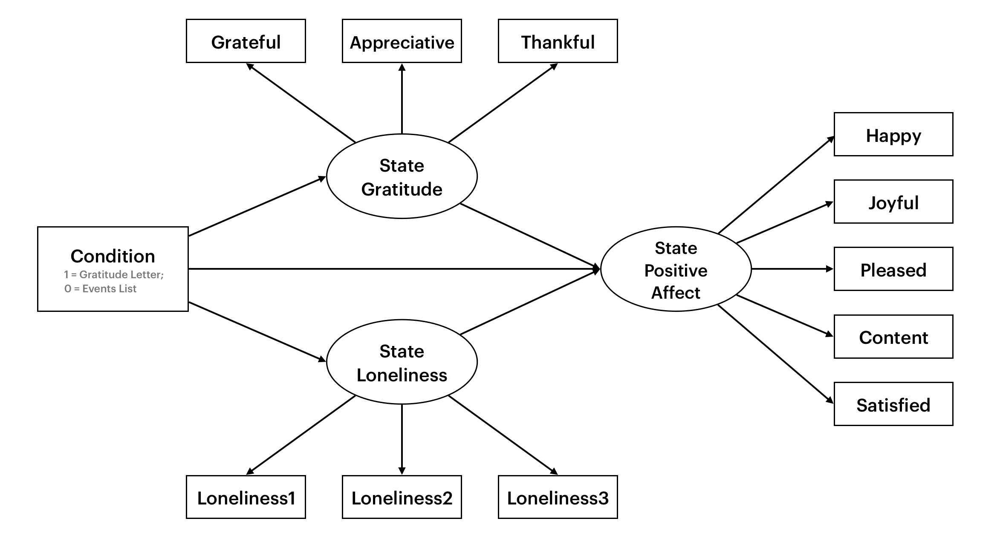

## Introduction

Dang et al. (2025) sought to test 7 gratitude interventions that are used in positive psychology to improve subjective well-being. These interventions included intrapersonal, interpersonal, and gratitude-to-God interventions. While studies in the literature have examined these interventions before, such studies are heterogeneous in their selection of outcome measures for subjective well-being and only compare a few interventions against each other, making comparisons across excluded interventions difficult. In contrast, this study included a comprehensive battery of interventions and standardized outcome measures (i.e., state gratitude, state positive/negative affect, and life satisfaction). As a result, the experiment allows for a direct comparison of efficacy between the gratitude interventions and can inform what gratitude practices are most helpful for the general public to incorporate into their lives.

In Study 1, Dang et al. (2025) found that writing a private gratitude letter was the most effective intervention in increasing positive affect. In this replication report, I wanted to replicate this finding and hoped to find a similarly large Hedges' $g$ of around $0.41$ when comparing this intervention to an active control. This replication study differs because we will test this effect in a student population as opposed to US adults from Prolific. This is aimed to increase the generalizability of the original study and offer guidance for students to improve their well-being. Furthermore, in case these interpersonal interventions caused increases to well-being because it reduces loneliness (rather than just improving gratitude), we also measure state loneliness to include as a parallel mediator with gratitude to isolate the unique effect that gratitude has on improving well-being.

## Methods

### Sample Size/Power Calculation for Key Confirmatory Test

The original Dang et al. (2025) study compared post-test positive affect scores between a gratitude letter writing condition and an events list writing condition and obtained a Hedges' $g = 0.41$. This is the key effect we aim to replicate.

Hedges' $g$ can be thought of as a bias-corrected form of Cohen's $d$ because Cohen's $d$ is upwardly biased (especially in small samples; Hedges, 2025; Liu, 2024). While the Dang et al. (2025) study reported the unbiased Hedges' $g$, many power analysis programs only offer sample size estimates based on Cohen's $d$. With larger samples, the difference between Hedges' $g$ and Cohen's $d$ becomes minimal as the $J(x)$ correction factor applied to Cohen's $d$ approaches 1 with large $n$ (Hedges, 1981, pp. 112–115)[^1]. However, for the sake of precision, the Hedges' $g$ was converted to a Cohen's $d$ for the power/sample size analysis. The conversion is explained below:

[^1]: $J(x)$ is denoted as $c(m)$ in Hedges (1981).

Because $g$ is the product of $J(x)\cdot d$, we can divide Hedges' $g$ by the $J(x)$ correction factor to recover Cohen's $d$, where $x=n_1+n_2-2$ for the correction factor $J(x)$. In Dang et al. (2025) Study 1, both conditions had exactly $n_1=n_2=126$ participants, therefore $x = 126+126-2=250$.

$$
\begin{aligned}
J(x) \cdot d &=g \\
d &= \frac{g}{J(x)}\\d & = \frac{g}{\dfrac{\Gamma(x/2)}{\sqrt{x/2}\times\Gamma((x-1)/2)}}\\\\
&\# \text{Substitute $J(x) = J(250)$}\\
d&=g\times 
\frac{\sqrt{250/2}\times \Gamma((250-1)/2)}{\Gamma(250/2)}\\d&=g\times \frac{\sqrt{125}\times \Gamma(124.5)}{\Gamma(125)}\\d&=g\times 1.003013...
\end{aligned}
$$

```{r}
# Calculate Correction Factor and Assign it to J_250
J_250 <- sqrt(125) * gamma(124.5) / gamma(125)

# Multiply g = 0.41 by the J(250) correction factor
ComputedCohens_d <- 0.41 * J_250
```

Now that the Cohen's $d$ has been computed ($d$ = `{r} round(ComputedCohens_d, digits = 3)`...), we used the `pwr` package in R to perform a sample size analysis for 80% power.

```{r}
#| output: false
# Step 1: Set CRAN as the source to install `pwr`
options(repos = c(CRAN = "https://cloud.r-project.org"))

# Step 2: Install `pwr`
install.packages("pwr")

# Step 3: Load `pwr` into the current session
library(pwr)

# Step 4: Calculate Power
Power80 = pwr.t.test(d = ComputedCohens_d,
           sig.level = .05,
           power = .80,
           type = "two.sample",
           alternative = "two.sided")
```

At an alpha level of $\alpha =.05$, for 80% power ($1 - \beta = .80$), we are going to need `{r} round(Power80$n,0)` participants per group. In total, that will be `{r} ceiling( 2 * Power80$n )` participants.

For a balance of power and practicality, we will aim for a power level of at least 80% which will require 188 participants. An additional 10% margin will be collected in case of participant attrition for follow-up analyses which will result in collecting data until we reach `{r} ceiling(188*1.1)` participants. Considering that the study is an online survey experiment that takes less than 30 minutes, this should balance both practicality as well as statistical validity and power concerns. Data collection will have to end before the end of the Fall 2026 term.

### Participants

Participants will be recruited from the University of California San Diego. There will likely be no adverse effects of the study. However, if any are reported by participants, data collection will stop immediately. The researchers will reconvene and discuss whether it is appropriate to end the study entirely.

### Materials & Procedure

Study materials include the jsPsych code (de Leeuw et al., 2023) used to run the experiment as well as the stimuli described below. Participants will also need access to a computer and an internet connection to complete the study.

After reading an informed consent form, consenting participants are welcomed into the study. They first fill out demographic information about their age, gender identity, and racial identity. Proceeding after that, participants answer a 1-item mood question and then are randomized to participate in either the events list or gratitude letter condition. Directly after, participants are asked to respond to questions that assessed state loneliness, state gratitude, and state positive affect. Each construct is measured in its own block; however, within each block, the order of the items are randomized. Participants then pass an AI Captcha. Lastly, participants will be thanked for their participation in the study and are debriefed on the study's aims and we inform participants about the study design and what prior literature inspired this study. At the completion of the study, the experiment website will redirect students to Sona, where participants are automatically awarded research credits[^2] that can be used to fulfill course research participation requirements or confer extra credit in their courses.

[^2]: In this case, it will be 0.25 SONA credits for a roughly 30-minute study.

In the interest of replication, I will use the same instructions that were provided in the original study for the conditions (Cunha et al., 2019; Dang et al., 2025; Emmons & McCullough, 2003; Walsh et al., 2022). After participants are randomly assigned to a condition, they will see either of the following directions:

**Gratitude Letter (Walsh et al., 2022):** "In our daily lives, we often thank people for both large and small things. However, it can sometimes be difficult to make time to express our gratitude more deeply. Today, we want you to write a letter of gratitude to someone who has done something for which you are extremely grateful. Please do not share your letter with this person or anyone else.

Think of the people – partners, parents, siblings, relatives, friends, neighbors, mentors, and so on – who have been especially generous and thoughtful towards you. For example, you may feel grateful to a parent who has always been there for you, or to a friend who helped you through a hard time.

Now we would like you to pick ONE person who helped you, and write a letter of gratitude to them. However, this letter is really for you to express your thoughts—it is not to convey your gratitude directly to the other person. In fact, we do not want you to share your letter with anyone at all. You will type this letter out on the text box provided.

To give you some ideas of what to write, you could describe the kind act(s) this person did for you and how the kind act(s) affected your life. You could also describe what you are doing now and how you often remember their efforts."

**Control Group: Events List (Cunha et al. 2019):** "In life, there are events, both large and small, that end up affecting us. Think back over the past day and write down five events that somehow affected you."

Participants will also be told the following instructions from the original study (Dang et al., 2025):

\begin{quote}
As you write, don’t worry about perfect grammar and spelling, and remember that anything you write will remain strictly confidential. Should an experimenter read this entry in the future, it will be identifiable only by a participant number and not by your name.
\end{quote}

### Measures

#### ***Demographics***

Participants were asked to indicate their age, gender identity, and racial identity.

#### ***Mood***

At pre-test, participants are asked a 1-item question "How are you feeling right now?" with responses ranging from (1) *Very Bad* to (7) *Very Good*. This is a measure that was not present in the original study. However, due to the large sample size required, we will collect this data to allow us to control for baseline mood without measuring people's positive affect scores in the same way twice. This should increase our statistical power by controlling for people's baselines in case we do not get the ideal number of participants we had planned for.

#### ***State Loneliness***

On a scale from (1) *Not at All* to (7) *Very Much*, participants indicated their agreement with the following questions: "How lonely are you feeling? Compared to other people, how lonely do you think you are? To what extent do you feel lonely right now?" This state measure of loneliness was originally used by Choi et al. (2016) as an adapted version of a measure used by Shaver et al. (1985) and demonstrated good internal consistency in the Choi et al. (2016) study (Cronbach's $\alpha=.92$). It is important that this measure of loneliness was a *state* measure as opposed to a *trait* measure as we wanted to see if momentary fluctuations in loneliness as a result of our intervention may explain some of the effect that our writing conditions had on positive affect.

#### ***State Gratitude***

On a scale from (1) *Strongly Disagree* to (7) *Strongly Agree*, participants rated how much they agreed with three adjectives: "grateful," "appreciative," and "thankful" (Dang et al., 2025). The order of these items were randomized. This scale also demonstrated good internal consistency in the original study (McDonald's $\omega$ = .93).[^3]

[^3]: McDonald's Omega describes the proportion of variance in the indicators that is explained by a general latent factor compared to the overall amount of variance in the indicators with the highest score being 1. $\omega = \dfrac{\left(\sum_{i=1} ^k\lambda_i\right)^2}{\left(\sum_{i=1}^k\lambda_{i}\right)^2+\sum_{i=1}^k\psi_i}$, where $\psi:=1-\lambda_i^2$.

#### ***State Positive Affect***

On a scale from (1) *Strongly Disagree* to (7) *Strongly Agree*, participants rated how much they agreed with five adjectives: "happy," "joyful," "pleased," "content," and "satisfied" (Dang et al., 2025), with the order of the adjectives randomized. The original study demonstrated high internal consistency for this measure (McDonald's $\omega$ = .95). Positive affect was chosen as one dimension of subjective well-being to measure; however, theoretically speaking, negative affect and overall life satisfaction are other key components to subjective well-being (Diener et al., 2022).

### Statistical Analysis Plan

#### Data Cleaning

Data and code will be made publicly available. However, since the events and letters are quite personal and we promised participants confidentiality, we will remove participant responses to free-response questions (i.e., the written response to the event or letter writing condition). The only remaining information will be a newly randomly generated participant ID, their age, gender, ethnoracial identity, their scores across the likert scales, and how long they took to complete the study. Additionally, free-response answers to gender identity or ethnoracial identity will be recoded as "Other" unless at least 10 participants endorse a given response to protect participant privacy.

The original study used an intent-to-treat analysis (Ahn et al., 2023, Dang et al., 2025), which meant that they did not exclude any participants from the study. This is aimed to measure the generalizable real-world impact of an intervention and acknowledge that attrition and non-compliance are inseparable downstream effects of the intervention. Since this study is meant to inform us about real student populations, it is vital to understand the realistic intent-to-treat effect size as opposed to the effect size found in an artificially controlled setting. Due to these reasons and in the interest of replication, I will also use an intent-to-treat analysis for the key confirmatory test.

In order to prevent bot responses, invisible white text prompt injection is used in an attempt to catch AI responses. If a participant responds to the prompt, their data will be row-wise deleted.

#### ***Key Confirmatory Test:*** $t$***-Test of Mean Positive Affect Scores Across Condition***

Confirmatory analyses will be performed using the R programming language (R Core Team, 2026). Our key confirmatory test will be a $t$-test comparing average positive affect scores across the letter writing (experimental) vs. event writing (control) conditions. Using an alpha threshold of $\alpha = .05$ that was chosen during our power/sample size analysis, I will use the `t.test` function to compute the $t$-test test statistic and return a $p$-value. I will also use the `rstatix` package to compute a Cohen's $d$ which I will convert to Hedges' $g$ using Hedges' $J(x)$ correction where $x$ is the degrees of freedom for the $t$-test. This will represent the intent-to-treat effect that most closely matches Dang et al. (2025). In order to calculate positive affect scores, a simple arithmetic mean will be calculated across its items.

For the later exploratory analyses, positive affect scores will be calculated as a latent variable. For this first analysis, no participant will be excluded to calculate the intent-to-treat effect (besides suspected bot/AI responses) and no latent variables will be used.

#### ***Exploratory Analysis 1: Exclusion of Speeders***

While the intent-to-treat analysis shows a real-world response to the intervention, since we have the data, we can also calculate the effect while excluding people who may have sped past the study. This effect size can be interpreted as the effect of the intervention under more ideal conditions. For this exploratory analysis, participants who spent a total time in the study of less than 2 standard deviations under the median will be excluded. This exclusion criteria is used commonly in survey research and is the criteria that Qualtrics typically uses to identify participants who completed a survey abnormally fast (often called "speeders"; Qualtrics, 2026). This is to test whether the observed intent-to-treat effect is attenuated by participants who speed past the intervention without giving it much thought.

For Exploratory Analysis 1, we will run the same $t$-test procedure as the Key Confirmatory Test but exclude participants who spent a total time in the study that is less than 2 standard deviations below the median time spent in the study.

#### ***Exploratory Analysis 2: Estimating a Parallel Mediation Model Using Structural Equation Modeling***

For the exploratory analyses involving structural equation modeling (SEM), I will use lavaan (version 0.7-3; 2026, October 8th release), a popular and free R package to estimate multivariate models (e.g., path analysis) and perform latent variable analysis (e.g., confirmatory factor analysis, structural regression, and latent growth models; Rosseel, 2012). In this first analysis, I will use state gratitude and state loneliness as latent variables that mediate the effect that condition has on state positive affect (which will also be a latent variable).

Missing data will be handled with Full Information Maximum Likelihood (FIML) which handles missing data better than list-wise deletion or data imputation. Additionally, we will specify the use of maximum likelihood with robust standard errors (MLR) which handles non-normality better than maximum likelihood estimation when estimating standard errors. This exploratory analysis will be estimated for the intent-to-treat effect (without excluding speeders) and will use pre-test mood as an observed variable that is covaried along all paths.

The SEM will be estimated in two steps:

1.  In the first step, we calculate the total effect of Condition on State Positive Affect while controlling for pre-test mood.
2.  And in the second step, we add the mediators.
3.  Indirect effects will be calculated using bootstrapped standard errors. If possible, we specify 10,000 iterations.

**Exploratory Analysis 2 Model A: Total Effect of Condition on State Positive Affect While Controlling for Pretest Mood**

```         
StatePositiveAffect BY Happy Joyful Pleased Content Satisfied
StatePositiveAffect ON Condition PretestMood
```

**Exploratory Analysis 2 Model B: Estimating the Parallel Mediation Model**

```         
# Measurement
StateGratitude        BY Grateful Appreciative Thankful
StatePositiveAffect   BY Happy Joyful Pleased Content Satisfied
StateLoneliness       BY Loneliness1 Loneliness2 Loneliness3

# Structural Regression
StatePositiveAffect   ON StateGratitude StateLoneliness Condition PretestMood
StateGratitude        ON Condition PretestMood
StateLoneliness       ON Condition PretestMood
```

The proposed model is outlined in Figure 1.

**Figure 1** *Preregistered Structural Equation Model for Exploratory Analysis 1*



#### Differences from Original Study in Analysis

There are a few key differences from the original study, making the present study a replication and extension. Firstly, I will only be testing two conditions and measuring one dependent variable. Additionally, rather than immediately measuring positive affect after the intervention, I will first measure state loneliness and state gratitude. Thinking about loneliness prior to measuring state positive affect may attenuate positive affect scores; however, this was necessary for the exploratory mediation model to satisfy temporal precedence of the mediators. Additionally, participants for the original study were recruited from Prolific; however, the current study will recruit UC San Diego's undergraduate students to participate, which will extend the findings to a student population.

### Analysis Code for Confirmatory Test

```         
%pip install pandas numpy rpy2
import pandas as pd
import numpy as np

# Load rpy2 R to Python Extension Bridge
%load_ext rpy2.ipython

# Filtering Out AI Captcha. Only keep participants who did not respond to the captcha.
Tensor = Tensor[Tensor['AI_Captcha'] == ""]

# Because we have not collected data, I will simulate the test.
```

```{r}
#| output: false
library(dplyr)
# Simulate data. Shift data by the approximate difference in means. (Hedges' g = .41)
EventsData <- rnorm(n = 94, m = 0, sd = 1)
LetterData <- rnorm(n = 94, m = .41, sd = 1)

StackedData <- stack(list(Event = EventsData, Letter = LetterData))
StackedData <- rename(StackedData, "PositiveAffectScores" = "values")
StackedData <- rename(StackedData, "Condition" = "ind")
StackedData
```

```{r}
#| output: false
KeyResults <- t.test(PositiveAffectScores ~ Condition,
                     alternative = "two.sided",
                     var.equal = TRUE,
                     data = StackedData)
```

*t*(`r round(KeyResults$parameter)`) = `r round(KeyResults$statistic, 2)`, *p* = `r round(KeyResults$p.value, 3)` .

```{r}

install.packages("rstatix")
library(rstatix)

#Degrees of Freedom
DegFr = as.numeric(KeyResults$parameter)
J_Correction = gamma(DegFr/2) / (sqrt(DegFr/2)*gamma((DegFr-1)/2))

CohenD <- cohens_d(PositiveAffectScores ~ Condition, data = StackedData, var.equal = TRUE)

HedgesG <- J_Correction * CohenD$effsize
HedgesG
```

## References

Ahn, E., & Kang, H. (2023). Intention-to-treat versus as-treated versus per-protocol approaches to analysis. *Korean Journal of Anesthesiology*, *76*(6), 531–539. <https://doi.org/10.4097/kja.23278>

Choi, J., Rangan, P., & Singh, S. N. (2016). Do cold images cause cold-heartedness? The impact of visual stimuli on the effectiveness of negative emotional charity appeals. *Journal of Advertising*, *45*(4), 417-426.

Cunha, L. F., Pellanda, L. C., & Reppold, C. T. (2019). Positive psychology and gratitude interventions: A randomized clinical trial. *Frontiers in Psychology*, *10*. https://doi.org/10.3389/fpsyg.2019.00584

Dang, A. V., Coles, N. A., Oishi, S., & McCullough, M. E. f(2026). The efficacy of seven gratitude interventions for promoting subjective well-being. *The Journal of Positive Psychology*, *21*(3), 517–535. https://doi.org/10.1080/17439760.2025.2502483

de Leeuw, J. R., Gilbert, R. A., & Luchterhandt, B. (2023). jsPsych: Enabling an open-source collaborative ecosystem of behavioral experiments. *Journal of Open Source Software*, *8*(85), Article 5351, <https://joss.theoj.org/papers/10.21105/joss.05351.>

Diener, E., Oishi, S., & Lucas, R. E. (2002). Subjective well-being: The science of happiness and life satisfaction. *Handbook of Positive Psychology*, 463–473. <https://doi.org/10.1093/> oxfordhb/9780195187243.013.0017

Emmons, R. A., & McCullough, M. E. (2003). Counting blessings versus burdens: An experimental investigation of gratitude and subjective well-being in daily life. *Journal of Personality & Social Psychology*, *84*(2), 377–389. https://doi.org/10.1037/0022-3514.84.2.377

Hedges, L. V. (1981). Distribution theory for Glass's estimator of effect size and related estimators. *Journal of Educational Statistics*, *6*(2), 107–128. https://doi.org/10.2307/1164588

Hedges, L. V. (2025). Effect sizes for experimental research. *The British Journal of Mathematical and Statistical Psychology*, *79*(1), 31–45. https://doi.org/10.1111/bmsp.12389

Liu, X. S. (2024). Bias correction for Cohen's *d*. *The Journal of General Psychology*, *151*(1), 54–62. https://doi.org/10.1080/00221309.2023.2172545

Qualtrics. (2026). *Response quality*. Qualtrics. Retrieved November 11, 2026, from https://www.qualtrics.com/support/survey-platform/survey-module/survey-checker/response-quality/

R Core Team. (2026). *R: A language and environment for statistical computing*. R Foundation for Statistical Computing. https://www.R-project.org/

Rosseel, Y. (2012). lavaan: An R package for structural equation modeling. *Journal of Statistical Software*, *48*(2), 1–36. https://doi.org/10.18637/jss.v048.i02

Shaver, P., Furman, W., & Buhrmester, D. (1985). Transition to college: Network changes, social skills, and loneliness. In S. Duck & D. Perlman (Eds.), *Understanding personal relationships: An interdisciplinary approach* (pp. 193–219). Sage Publications, Inc.

Walsh, L. C., Regan, A., Twenge, J. M., & Lyubomirsky, S. (2022). What is the optimal way to give thanks? comparing the effects of gratitude expressed privately, one-to-one via text, or publicly on social media. *Affective Science*, *4*(1), 82–91. https://doi.org/10.1007/s42761-022-00150-5